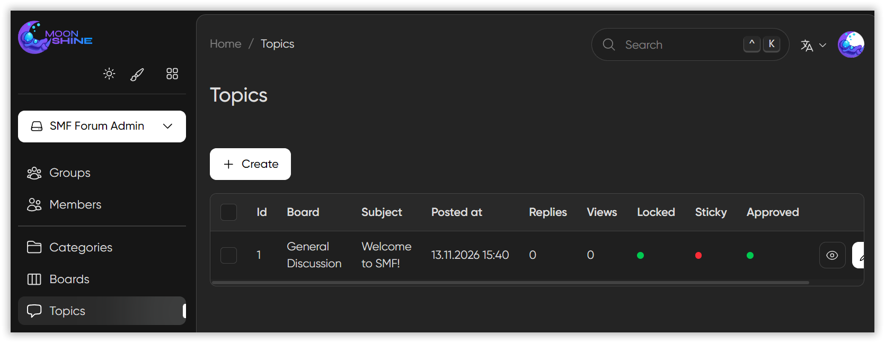

# Example: a MoonShine V admin panel over the SMF RESTful API

A self-contained Docker Compose stack demonstrating what the SMF RESTful API
can drive: an SMF 2.1.8 forum **with this mod already installed** and a
[MoonShine V](https://github.com/moonshine-software/v) admin panel that manages
the forum through the API — CRUD for members, groups, categories, boards and
topics, drag-and-drop reordering, localized resources, API-driven dropdowns and
links between resources.

> Русская версия: [README.ru.md](README.ru.md)



## Quick start

1. Save the SMF forum archive into `dockerfiles/downloads/` — download it in
   a **browser** from <https://download.simplemachines.org/> (the mirror sits
   behind Cloudflare and blocks scripted fetches such as `curl`):
   - `smf_2-1-8_install.zip`
2. Pack the mod archive from this repository's sources:

   ```bash
   docker compose run --rm mod-build
   ```

3. Copy `.env.example` to `.env` and review the defaults (host ports, the API
   key, the panel administrator).
4. `docker compose up -d --build`
5. Forum: <http://localhost:8085> — administrator `Test` / `test` (seeded).
   Panel: <https://localhost:8080/admin> — `admin@localhost` / `change-me`.

No manual setup on the panel side: the one-shot `moonshine-seed` service
registers the `smf_forum` service (the API key comes from `SMF_API_KEY` in
`.env`) and generates the five panel resources from the forum API on every
boot — it waits for the forum API to answer first and skips what already
exists.

MoonShine source fixes are applied by the single entry point
`docker/apply-patches.php` during the image build. Runtime fixes are reapplied
when the storage volume is initialized; an incompatible upstream anchor fails
with the name of the affected patch. Transformations of the five SMF resources
remain separate in `docker/gen-smf-resources.php`.

The forum boots pre-installed from `dockerfiles/dump.sql`: the mod is already
registered with Package Manager and its files are in place. The mod archive
is packed by `docker compose run --rm mod-build` from this very repository
(`src/` at its root) and is required before the first image build — see the
"Rebuilding the mod" section in the full documentation. No SMF language packs
are needed: without them the forum uses its built-in English files (any
official `smf_<version>_language-*.zip` placed into `dockerfiles/downloads/`
is installed automatically, should you ever want one).

## Documentation

- English: [STACK.md](STACK.md)
- Русский: [STACK.ru.md](STACK.ru.md)
