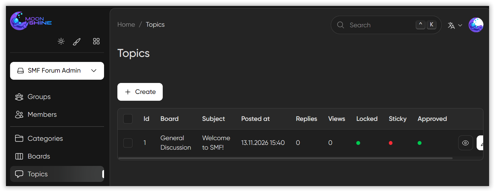

# Пример: админ-панель MoonShine V поверх SMF RESTful API

Самодостаточный Docker Compose стек, показывающий, на что способен SMF RESTful
API: форум SMF 2.1.8, **в котором этот мод уже установлен**, и админ-панель
[MoonShine V](https://github.com/moonshine-software/v), управляющая форумом
через API — CRUD участников, групп, категорий, разделов и тем, сортировка
перетаскиванием, локализованные ресурсы, выпадающие списки и ссылки между
ресурсами на данных API.

> English version: [README.md](README.md)



## Быстрый старт

1. Положите архивы SMF в `dockerfiles/downloads/` — скачайте их
   **в браузере** с <https://download.simplemachines.org/> (зеркало за
   Cloudflare и блокирует скриптовые запросы вроде `curl`):
   - `smf_2-1-8_install.zip` — сам форум
   - `smf_2-1-8_language-russian.zip` — русификация форума
2. Соберите архив мода из исходников этого репозитория:

   ```bash
   docker compose run --rm mod-build
   ```

3. Скопируйте `.env.example` в `.env` и проверьте значения (порты хоста,
   API-ключ, администратор панели).
4. `docker compose up -d --build`
5. Форум: <http://localhost:8085> — администратор `Test` / `test` (из дампа).
   Панель: <https://localhost:8080/admin> — `admin@localhost` / `change-me`.

Ручная настройка панели не нужна: one-shot сервис `moonshine-seed`
регистрирует сервис `smf_forum` (API-ключ берётся из `SMF_API_KEY` в `.env`) и
генерирует пять ресурсов панели из API форума при каждом запуске — сначала он
дожидается ответа API форума, а всё уже созданное пропускает.

Исправления исходников MoonShine применяются единым входным скриптом
`docker/apply-patches.php` при сборке. При инициализации тома он повторно
применяет runtime-часть; несовместимый upstream-якорь приводит к ошибке с
именем конкретного патча. Преобразования пяти SMF-ресурсов остаются отдельно
в `docker/gen-smf-resources.php`.

Форум разворачивается предустановленным из `dockerfiles/dump.sql`: мод уже
зарегистрирован в Package Manager, его файлы на месте. Архив мода собирается
командой `docker compose run --rm mod-build` из `src/` этого же репозитория
и нужен до первой сборки образов — см. раздел «Пересборка мода» в полной
документации. Языковые пакеты SMF не обязательны: без них форум работает на
встроенном английском; любой официальный архив
`smf_<версия>_language-*.zip`, положенный в `dockerfiles/downloads/`,
устанавливается автоматически при сборке.

## Документация

- Русский: [STACK.ru.md](STACK.ru.md)
- English: [STACK.md](STACK.md)
